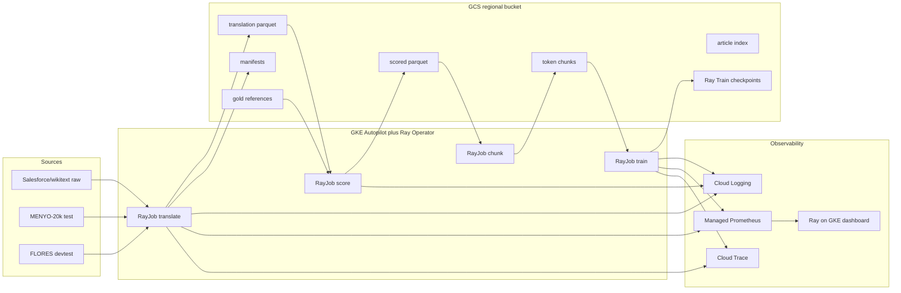

# Ìròyìn-Ray implementation plan

Internal research pipeline: translate English Wikitext-103 raw into Yoruba, score it, and pretrain a small causal language model with Ray Train on GKE. This plan is the build contract for the first working system. Later sections are labeled as later. Dates and model cards below were checked on 26 November 2026.

Assumption that frames every milestone: the corpus is for internal research, not a shipped product and not a public dataset release. NLLB weights are CC-BY-NC, and the model card says the model is not released for production deployment. Wikitext text comes from Wikipedia, which is CC BY-SA, so a translation is a derivative work. Those two licenses are not something this plan resolves. See open decision 1.

## 1. Overview

Ìròyìn-Ray is four jobs and a cluster, not one script.

1. A Ray Data job reads `Salesforce/wikitext`, config `wikitext-103-raw-v1`, splits English into sentences, translates each sentence with NLLB (`eng_Latn` → `yor_Latn`), and writes Parquet plus a commit manifest to GCS.
2. A second Ray Data job scores those rows and writes a new Parquet version. It does not rewrite the translation files.
3. A small CPU job trains a Yoruba SentencePiece model and materializes fixed-length token chunks.
4. A Ray Train `TorchTrainer` job, written in the shape of the official PyTorch tutorial [Distributed training at scale with PyTorch and Ray Train](https://docs.pytorch.org/tutorials/beginner/distributed_training_with_ray_tutorial.html), streams those chunks and trains a from-scratch GPT-2 small with DDP.

The tutorial was read end to end before this training section was written. It trains `GPT2LMHeadModel` (~123.8M parameters) on the same Wikitext split, with Ray Data `map_batches` tokenization, `TorchTrainer`, `prepare_model` (DDP), `iter_torch_batches`, and `ray.train.report` plus `Checkpoint.from_directory`. Its stack line is PyTorch 2.9+ and Ray Train 2.52.1+. The page chrome on the day it was read said `v2.15.0+cu132`. Pin the image to that tutorial floor, not to `:latest`.

What is deliberately different from the tutorial, and why:

| Tutorial | Ìròyìn-Ray | Why |
| --- | --- | --- |
| `tiktoken` GPT-2 encoding, vocab 50,257 | SentencePiece Unigram, vocab 32,768, trained on the filtered Yoruba text | GPT-2 BPE fragments `ẹ ọ ṣ` and tone marks into bytes. That wastes context and hides orthography from the model. |
| Tokenize inside the training dataset, per batch | Materialize chunks to GCS, one Ray Data pass, then stream the chunk Parquet | A batch-local concat crosses articles whenever a title is not in the same batch. Chunking per article, in order, is the version of the tutorial's `<\|endoftext\|>` rule that actually holds. |
| `storage_path` local or `s3://` in the write-up | `gs://` on `RunConfig.storage_path` | Ray Train documents `gs://` via PyArrow's GCS filesystem. This is the native path. GCSFuse is not required for checkpoints. |
| Report once per epoch, per worker, no all-reduce | Smoke matches the tutorial (report once per epoch). The multi-GPU run all-reduces loss and token counts, reports every 50 steps, checkpoints every 500 steps | An epoch is hours. Fault tolerance is fiction if the only checkpoint is at the end of the epoch. Per-worker losses are not the number we want in Cloud Monitoring. |
| fp32, constant LR `3e-4` | Smoke is fp32 and `3e-4`, matching the tutorial. bf16 autocast is allowed only after the fp32 smoke loss is finite | An AMP bug must not be the first thing we debug. |

Locked defaults, so a build can start without another design pass:

- Smoke translator: `facebook/nllb-200-distilled-600M`. Quality translator: `facebook/nllb-200-distilled-1.3B`. Escalate to `facebook/nllb-200-3.3B` only if the preflight rule in section 3 says so.
- Languages: tokenizer source `eng_Latn`, forced target `yor_Latn`. The Hugging Face NLLB doc notes the tokenizer was changed in April 2023 to prefix the source language, not the target. Use the current `transformers` NLLB path. Do not add a Fairseq stack.
- Beam 4 and `max_new_tokens` 256 for quality. Greedy (beam 1) only for the 2,000-sentence plumbing test.
- Preflight set: MENYO-20k **test**, English → Yoruba, Hugging Face id `UdS-LSV/menyo20k_mt` (there is no `masakhane/menyo20k` id to load; the Masakhane paper's corpus is this release). Second gate: FLORES-200 `eng_Latn-yor_Latn` **devtest** (1,012 sentences) from `facebook/flores`, because that English side is Wikipedia and matches Wikitext better than MENYO.
- Reference metric on the gold set: chrF++ via sacrebleu with `word_order=2`, plus `McGill-NLP/ssa-comet-mtl`. AfriCOMET-1.1 (`masakhane/africomet-stl-1.1`) is a second opinion on the gold set only. SSA-COMET is the 2025 successor (EMNLP 2025; it reports better correlation than AfriCOMET). On the WMT 2025 SSA-MTE challenge set, SSA-COMET-MTL was Spearman 0.630 versus a reproduced AfriCOMET-1.1-MTL at 0.552, and COMETKiwi22 at 0.244. CometKiwi is not a gate.
- Every-row QE: `McGill-NLP/ssa-comet-qe` (Yoruba is in its "specifically finetuned" list; scores are 0–1). The card still says "Coming soon" in one block while also publishing a `comet` usage snippet. If `download_model` fails, use `masakhane/africomet-qe-stl-1.1`. Do not block the build on `McGill-NLP/ssa-comet-qe-final` (a 114-language encoder card that also says "Coming soon").
- LLM judge: a stratified sample, never the full corpus. Cloud Translation Advanced NMT (`yo`) is a ceiling on that same sample, never the default translator.
- Train: from-scratch GPT-2 small, DDP, 1 GPU smoke then one 4×L4 pod.
- Cluster: GKE Autopilot, region `us-central1`, Ray Operator addon, Ray log collection, Ray metrics collection. Spot L4 for translation, T4 as the second ComputeClass priority. The 4-GPU train pod is on-demand.

## Sub-$10 smoke profile

This is the first thing that runs. It uses the same Google pieces as the rest of the plan: one GKE Autopilot cluster, the Ray Operator, GCS, Cloud Logging, Managed Prometheus, and Cloud Trace. It does not switch clouds and it does not run on a laptop. Milestones 1–8 and the first-week checklist stay in this document as later work. They are outside this cap.

Hard cap: one run, all-in, under $10. That includes GPU time, Autopilot pod time, the cluster management fee, GCS, logging, and trace. The table below uses the top of the section 7 spot band ($0.80 per L4-hour) plus the fixed fees that the GKE pricing page actually lists. The sum is $2.40. Headroom under $10 is for a slower spot price inside that band, not for a second model.

### What runs

One cluster, name `iroyin-ray-smoke`, region `us-central1`, regular release channel (not Extended). Flags are the same three as the later cluster: `--enable-ray-operator`, `--enable-ray-cluster-logging`, `--enable-ray-cluster-monitoring`. ComputeClass `l4-spot`: spot `nvidia-l4` count 1, then spot `nvidia-tesla-t4` count 1, `whenUnsatisfiable: DoNotScaleUp`.

One `RayJob`. `shutdownAfterJobFinishes: true`. One worker, `nvidia.com/gpu: 1`, node selector `cloud.google.com/compute-class: l4-spot`. Requests are 3 CPU and 12Gi, not the later job's 8 CPU and 32Gi. Autopilot bills a GPU pod for the whole node it places (GKE pricing: node-based billing once a pod selects an accelerator). 3 CPU and 12Gi is meant to land on `g2-standard-4` (4 vCPU, 16 GB, one L4). After the pod is scheduled, if the node type is anything larger, delete the cluster and fix the requests before continuing. The head is a general-purpose pod, 2 CPU and 4Gi, no GPU. Image is the public `rayproject/ray:2.54.0-py311-gpu`. Install the Python packages inside the job. No Cloud Build and no Artifact Registry on this run.

The job, on that one GPU, in this order:

1. Stream `Salesforce/wikitext` `wikitext-103-raw-v1` only until there are 2,000 English body sentences. Do not index the full 1,801,350 lines.
2. Translate them with `facebook/nllb-200-distilled-600M`, `eng_Latn` → `yor_Latn`, greedy (beam 1), `max_new_tokens` 256. Section 7's planning rate is 25 sentences/s, which is about a minute and a half of GPU. The clock budget is the 90 minutes below, not that rate.
3. Run the hard filters on those rows (they are CPU and free).
4. Score those 2,000 rows with `masakhane/africomet-qe-stl-1.1`, and with `McGill-NLP/ssa-comet-qe` only if that checkpoint loads without a second attempt. Section 7's planning rate is 40 pairs/s, about a minute of GPU, so the neural score fits inside the same pod and does not add a line to the table. There is no gold text here, so there is no chrF++ and no SSA-COMET-MTL. If the clock passes 60 minutes before scoring starts, skip the neural model and keep the heuristic columns. The neural metric is the first thing cut. Do not load a third model.
5. Fit one SentencePiece Unigram (vocab 32,768, byte fallback) on the kept Yoruba. If the tokens-per-word check looks bad, record it and continue. A refit is a second run and is not allowed inside this cap.
6. Five-step GPT-2 smoke on the same GPU: `num_workers=1`, `max_steps_per_epoch=5`, block size 256, batch 16, fp32, AdamW, lr `3e-4`. One checkpoint.

Writes: one Parquet plus its `translate-partition` manifest under `gs://<project>-iroyin-ray/translations/v1/model=nllb-600m-smoke/`, and one checkpoint under `gs://<project>-iroyin-ray/ray-results/gpt2-yo-smoke-10/`.

Prove three instruments, then stop:

- One Cloud Logging query returns the job: `resource.type="k8s_container" labels."k8s-pod/ray_io/is-ray-node"="yes"`. Log one JSON line for the part, not one line per sentence.
- One Managed Prometheus series is visible in Metrics Explorer (`iroyin_translation_sentences_total`, or a `prometheus/ray_` series if the custom counter is not up yet).
- One Cloud Trace span from this job is visible (`translate.partition` is enough). Ray still does not emit that span by itself.

Then delete the cluster the same day.

### What is excluded

Each line is out because putting it in this run can, by itself, pass $10. The later milestones are unchanged.

| Excluded | Why it cannot be inside $10 |
| --- | --- |
| `facebook/nllb-200-distilled-1.3B` and `facebook/nllb-200-3.3B` | They are the quality ladder, not this run. The three-model preflight in section 7 is $5–$30. A second weight download also spends the 90-minute clock. |
| Full MENYO-20k test and FLORES devtest | 6,633 + 1,012 sentences, and the selection rule wants more than one model. Same $5–$30 band. |
| The 50,000-sentence subset | Milestone 2, two GPUs, and a deliberate preemption. If the 25 sentences/s assumption is high and a worker retries, that job does not fit in one 90-minute pod. |
| Full Wikitext translation | About 60 GPU-hours, $15–$70 in section 7. |
| Full-corpus QE | About 9 GPU-hours, $5–$20. Scoring the 2,000 stays; scoring the corpus does not. |
| 4×L4 training | On-demand, $50–$150, ComputeClass `l4-train`. |
| Gemini | Section 7's band is tens of dollars, on a different service account. |
| Cloud Translation | The smoke GSA has no Translation role. Two thousand sentences would fall in the free character tier, and the API stays off so a bug cannot call it. The full-corpus list price is about $3,000. |
| Human annotation | $1,500–$5,000, and it is not this infra. |

### Dollar table

Lifetime used for every timed row: 1.5 hours. That is the 90-minute kill, not the expected GPU compute (translation plus scoring plus five steps is minutes once the weights are loaded). Rates are the top of the section 7 spot band, or a figure from the GKE pricing page where one was checked. Nothing here is a reserved quote. Spot moves; the GKE pricing footnote says spot can change up to once every 30 days, and the Spot VM page says up to once a day. Before `create-auto`, read the pricing calculator for a spot `g2-standard-4` in `us-central1` and add the Autopilot L4 premium. If that node rate is R dollars per hour, set the lifetime to `min(1.5 hours, $8 / R)` and do not start if R is above $5.

| Line | How the amount is computed | Amount |
| --- | --- | --- |
| Cluster management fee | 1.5 h × $0.10/h. The GKE pricing page charges this for every Autopilot cluster, in 1-second increments. The same page's free tier is $74.40 per billing account per month and covers one Autopilot cluster's management fee only, not compute. This row assumes the credit is already used. | $0.15 |
| Spot L4 node | 1.5 h × $0.80/h, the top of the section 7 band ($0.20–$0.80 per L4-hour spot). At the bottom of that band this row is $0.30. The $0.80 is a planning ceiling for the whole small GPU node, not a SKU copied from a calculator. | $1.20 |
| Autopilot L4 premium | 1.5 × $0.02. Spot column of "GKE Autopilot L4 GPU Premium (GPU)" on the GKE pricing page, regions that include Iowa (`us-central1`). | $0.03 |
| Autopilot accelerator CPU and memory premium | 1.5 h × (4 vCPU × $0.0011 + 16 GiB × $0.00013), spot column of the accelerator premium table on that page, for a `g2-standard-4`-sized node. | $0.01 |
| Head and Ray Operator | 1.5 h at the default (non-spot) general-purpose rates on that page: 2 vCPU × $0.0445 and 4 GiB × $0.0049225, plus a 0.5 vCPU / 1 GiB allowance for the operator. System DaemonSets are not charged. Using the non-spot rate on purpose, so a missed spot annotation on the head is already in the number. | $0.21 |
| GCS | One Parquet of 2,000 rows and one GPT-2 checkpoint, well under 1 GB-month. Planning band, not a re-checked storage SKU. Confirm regional standard storage and Class A operations on the Cloud Storage pricing page. | $0.05 |
| Cloud Logging | Ceiling if the project's free allotment is already gone and this run writes under 1 GiB. Planning band: confirm the current free GiB and the per-GiB rate on the Cloud Logging pricing page. The historical allotment is 50 GiB per project per month; inside it, this row is $0. | $0.50 |
| Managed Prometheus | Ceiling for a 90-minute scrape of one Ray node. Planning band: confirm the samples-ingested SKU in the Cloud Monitoring pricing calculator. Leaving a cluster scraping for days is what makes this row large, not the 90 minutes. | $0.25 |
| Cloud Trace | A handful of spans. Planning band $0 inside the free tier; confirm the current included span count on the Cloud Trace pricing page. | $0.00 |
| **Total** | High-band sum for one 90-minute run | **$2.40** |

Extended release channel is an extra $0.50 per cluster per hour on top of the $0.10, from the same GKE pricing page. This profile uses the regular channel, so that $0.50 is not in the total.

### Controls that keep the run under $10

The $2.40 total is not the control. These are:

- Create a $10 Cloud Billing budget alert before the cluster exists. An alert does not stop a VM, and it can lag. It is the tripwire, not the brake.
- Max lifetime 90 minutes (`activeDeadlineSeconds: 5400` on the RayJob if the CRD accepts it; if the API server rejects the field, the submitter deletes the RayJob at 90 minutes). At $0.80 per hour, a GPU node left up for 24 hours is about $19 and the cap is already gone. `shutdownAfterJobFinishes: true` releases the GPU pod when the job ends. Deleting the cluster the same day stops the $0.10 per hour fee, which is about $17 if a cluster sits for a week.
- If the GPU pod is still Pending after 15 minutes, delete the cluster. The GKE pricing page says unscheduled pods are not billed; a node is billed once it exists. Do not wait out a stockout inside the 90 minutes.
- One GPU, requests sized for `g2-standard-4`. Do not raise replicas, beam, or model size in this job.
- One log line per part. A logging exclusion on worker stdout if a library starts printing sentences. Two thousand sentence-sized log lines are what turns the $0.50 ceiling into real money only if something else is already logging at debug; still don't do it.
- No Cloud Translation role and no Vertex calls on this service account.

### Done when

This list is the completion check for the $10 profile only.

1. The $10 budget alert exists, and the cluster was created after it.
2. `iroyin-ray-smoke` came up in `us-central1` with the Ray Operator, Ray logging, and Ray metrics, and the GPU node was a 1-GPU L4 or T4.
3. The RayJob finished with `shutdownAfterJobFinishes`, inside 90 minutes, and translated 2,000 Wikitext sentences with distilled 600M, beam 1.
4. The Parquet, the manifest, and one checkpoint are in `gs://`.
5. Those 2,000 rows have heuristic filter columns, and either AfriCOMET-QE (or SSA-COMET-QE) scores or a recorded skip because the clock passed 60 minutes.
6. The five-step train logged a finite loss.
7. One Logging query, one Managed Prometheus series, and one Cloud Trace span were opened and match this job.
8. The cluster is deleted, and the day's charges for this project stay under $10.

## 2. High-level architecture



Control flow is Kubernetes, not a second orchestrator. A human or a small Cloud Build submit applies one `RayJob`. KubeRay creates a `RayCluster`, runs the entrypoint on the head, and deletes the worker pods when `shutdownAfterJobFinishes` is set. The next job is a different manifest. Do not run translation and training on the same live cluster: translation wants many preemptible 1-GPU pods; training wants one stable 4-GPU pod.

Data flow is append-only versions under one regional bucket. A partition is committed only when its manifest object exists. Scorers and the trainer read manifests, not a directory listing of Parquet, so a half-written file is invisible.

Observability is pull-and-export. GKE already ships container stdout to Cloud Logging and, with the Ray monitoring flag, scrapes Ray's Prometheus endpoint into Managed Prometheus. Cloud Trace spans exist only where our code starts them.

## 3. Implementation plan

Milestones are ordered. Do not start milestone N+1 because N is "mostly done."

### Milestone 1 — Preflight on MENYO-20k

Do this before any Wikitext translation beyond a 100-sentence plumbing check.

- Load `UdS-LSV/menyo20k_mt`. Direction is English → Yoruba: field `translation.en` to `translation.yo`. The test split is the published number (dataset card: 6,633 sentences, described there as 3,419 multi-domain, 1,714 news, 1,500 TED). The validation split (3,397) is the only place beam size may be chosen. The train split (10,070) is not used to fit or to select the model. MENYO's card says non-commercial use, because some sources (TED, JW news) need permission. Do not copy MENYO text into the LM corpus.
- The HF loader does not expose a domain column (features are only `translation.en` and `translation.yo`). Report one test number. If you also parse the upstream TSV from `uds-lsv/menyo-20k_MT` and a domain column is present, report per-domain chrF++ as an appendix. Do not block on it.
- Run, in this order, on one spot L4: `facebook/nllb-200-distilled-600M`, then `facebook/nllb-200-distilled-1.3B`. Add `facebook/nllb-200-3.3B` only if the rule below fires. Same decoding for all three.
- On validation only, compare beam 1 and beam 4 at `max_new_tokens=256`. Freeze the winner. Do not retune on test.
- Metrics on test, logged as one JSON object to GCS (`eval-run` manifest): sacrebleu chrF++ (`word_order=2`, and log the signature string), sacrebleu BLEU only as a secondary number, diacritic-word rate of hypotheses versus the same rate on the Yoruba references, underdot-sentence rate (share of sentences containing `ẹ`, `ọ`, or `ṣ`), and the copy-through hard-fail rate from section 5.
- Also run the frozen model on FLORES `facebook/flores` config `eng_Latn-yor_Latn`, split `devtest` (1,012 sentences; `dev` is 997 and is not the reported split). The dataset card says English-centric pairs use that hyphenated config name, and config `all` is the fallback if the pair config is missing. The card also points at `openlanguagedata/flores_plus` as the maintained successor. If `facebook/flores` will not load, switch to that repo and read its config name before scoring. FLORES-200 is CC BY-SA 4.0.
- chrF++ floor (pipeline-broken detector, not a quality target): if test chrF++ is under 20, stop. Wrong language code, a detokenizer bug, or greedy garbage all land here. This is not "Yoruba BLEU is usually 20." No published MENYO chrF++ for these exact checkpoints was treated as a target while writing this plan. AfriScience-MT numbers on the DSFSI fine-tunes (chrF around 18 on that scientific test) are a different test and are not the bar.
- Selection rule: take distilled 1.3B if its test chrF++ is within 2 points of the best model actually run **and** its hypothesis diacritic-word rate is at least half the MENYO reference diacritic-word rate. Otherwise run 3.3B once and apply the same comparison. If 600M wins on both, still prefer 1.3B when it is within 2 chrF++ points, because 600M is the smoke model, not the corpus model.
- A 30-sentence developer skim of test hypotheses is required before the rule is accepted. It is not the human evaluation in section 5.

Do not fine-tune NLLB in this milestone. The DSFSI checkpoints `dsfsi/nllb_200_distilled_600m-eng-yor` and `dsfsi/nllb_200_1.3b-eng-yor` are scientific-domain adaptations. Their published AfriScience test chrF is about 18. They are not the Wikitext model.

### Milestone 2 — Translation subset

- 100 sentences: one GPU, greedy, prove Parquet and manifest commit, then read the Parquet back with Ray Data.
- 2,000 sentences: beam frozen in milestone 1, heuristics attached, no QE model yet.
- 50,000 sentences: at least two spot GPUs, preempt one worker on purpose, confirm that partition resumes and does not duplicate rows.

The 50,000 are a deterministic sample: hash of `article_id` modulo 1000, take the first buckets until the sentence count crosses 50,000. Write them under `model=<id>` so a later model does not clobber them.

### Milestone 3 — Gold set and metrics

- Freeze the 1,000-sentence gold sample (section 5) **before** the full corpus job. Sampling does not depend on translation output.
- Implement chrF++ and SSA-COMET-MTL scoring against gold as soon as the first 100 references come back. Until then, the code path is tested by treating MENYO test as a stand-in reference file in the same schema.
- Run every-row QE on the 50,000. Publish a histogram. Do not tune the 0.40 placeholder by staring at that histogram; that leaks the filter into the metric. The placeholder moves only when human adequacy labels exist (milestone 3 human gate, then the 1,000-reference calibration).

### Milestone 4 — Full translation with QE

Start the full corpus only after both of these are true:

1. Milestone 1 selection rule passed.
2. The 200-item human evaluation on the 50,000-sentence system output meets the gate in section 5, or the user explicitly overrides that gate in writing.

QE is a second RayJob over committed translation manifests. It writes `scored/vN`. The trainer never reads `translations/` directly.

### Milestone 5 — Tokenizer

Train SentencePiece on the **kept** Yoruba text of the split you are about to train on (the 50,000 for a smoke LM; the full kept corpus before the real run). Vocab 32,768, Unigram, `character_coverage=0.9995`, byte fallback on, digits split. Reserve one user-defined symbol for the end-of-article marker and use that id wherever the tutorial uses tiktoken's `<|endoftext|>`. Upload `sentencepiece.model` and the `.vocab` sidecar to GCS. Record vocab size, character coverage, and the training-text SHA in an `eval-run` manifest of kind `tokenizer`.

Rejection test: encode 200 gold Yoruba references. If the mean tokens per whitespace word is above 4, the model is byte-fragmenting diacritics. Fix normalization (NFC, and do not NFKD-strip marks) and retrain before any GPU training.

Alternative tokenizer, not the default: the tokenizer that belongs to the base model, and only if milestone 9's continued-pretraining path is chosen. Do not mix a Gemma tokenizer with a from-scratch GPT-2.

### Milestone 6 — Smoke train

Mirror the tutorial's smoke switch. `num_workers=1`, `use_gpu=true`, `max_steps_per_epoch=5`, `block_size=256`, batch 16, lr `3e-4`, weight decay `0.1`, grad clip `1.0`, AdamW, fp32, 1 epoch is enough. Data is the chunk Parquet, limited the way the tutorial limits raw rows (`limit` on the order of 2,500 chunks).

Pass criteria: finite `train_loss` (random init on this setup is high; the tutorial's own smoke logs sit roughly in the 7–11 range, so a loss near 10 is expected and a NaN is a failure), a checkpoint object under `gs://…/ray-results/`, and a second submission whose first reported loss is within 1.0 of the previous run's last `train_loss`. If the second run starts near 10 again, resume is not wired. Ray does not resume merely because `storage_path` is set; the worker has to load the checkpoint Ray persisted. Follow the checkpoint guide linked from the tutorial rather than a guessed call.

### Milestone 7 — Multi-GPU train

First a 200-step NCCL proof on 4 GPUs, block size 512, batch 16 per worker (global batch 64 sequences, 32,768 tokens per step). Then the real run: 5 epochs, no step cap, report every 50 steps, checkpoint every 500 steps, `CheckpointConfig(num_to_keep=3)`, `FailureConfig(max_failures=3)`.

If the 4-GPU pod OOMs, drop per-worker batch to 8 before changing width or depth. Do not add gradient accumulation in this milestone; the tutorial does not use it.

bf16 autocast is allowed on L4 only after the 200-step fp32 proof. T4 has no bf16; if the ComputeClass falls back to T4, stay on fp32. If val loss goes NaN, turn autocast off.

Pass criteria: `tokens_per_sec` is non-zero and stable in Managed Prometheus, grad norm is finite, val loss is not worse than train loss by a wild margin after epoch 1 (a small gap is fine; divergence is not), and killing one GPU process loses at most the steps since the last checkpoint.

### Milestone 8 — Dashboards

Turn on the built-in Ray on GKE overview dashboard (it populates once `--enable-ray-cluster-monitoring` is set). Add one custom Cloud Monitoring dashboard with the `iroyin_*` metrics in section 6. Write the four log queries from the GKE Ray logging doc into the repo as saved filters. Confirm a sample of `translate.batch` spans in Cloud Trace. Export one PyTorch Profiler chrome trace to GCS and stop. Profiler stays off for the 5-epoch run.

## 4. Key technical decisions and trade-offs

**Translation model.** NLLB is the default because it has an explicit Yoruba target code (`yor_Latn`), a maintained `transformers` integration, and three sizes that fit L4. Distilled 600M is for smoke and for the broken-pipeline floor. Distilled 1.3B is the default corpus model (one GPU, fp16 weights about 2.6 GB). Dense 3.3B is the escalation (fp16 weights about 7 GB, still one L4 at batch 4–8). The non-distilled 1.3B checkpoint exists (`facebook/nllb-200-1.3B`) and is not in the default ladder; add it only if distilled 1.3B and 3.3B disagree in a way that looks like distillation damage.

Trade-off: NLLB's own card limits it to sentence-level research translation, inputs it was trained on up to 512 tokens, general-domain text, and non-commercial use. We stay inside those limits mechanically (sentence split, 256 new tokens, no document packing) and outside them legally if anyone ships the corpus. See open decision 1.

Commercial-weight alternative, to run in the same preflight if decision 1 goes that way: `google/madlad400-3b-mt`, Apache-2.0, Yoruba code `yo`, target prefix `<2yo>` as on its model card. It is a T5-style MT model trained on MADLAD-400. Expect it to lose to NLLB on Yoruba; AFRIDOC-MT (EMNLP 2025) found NLLB the stronger open NMT baseline on its African document set. It is the license escape hatch, not the quality pick. Cloud Translation NMT is the paid ceiling, not the corpus engine: at the current Advanced NMT list price of $20 per million characters after the first 500,000 characters in a month, a full Wikitext pass is thousands of dollars (section 7).

**Diacritics.** Do not assert that NLLB drops Yoruba tone marks. A 2025 code-switch paper (AfroCS-xs) observed the opposite failure on NLLB-200-3.3B: it kept full diacritics from its pretraining data and ignored a tone-only target style. Under-marking is still a widely reported operational risk, and ASCII-stripping in our own pipeline would cause it even if the model is fine. The plan measures both. Yo-ByT5 (2026) cites Orife 2018: in a roughly one-million-word Yoruba corpus, about 85% of words carry diacritics, and unmarked forms are highly ambiguous (`igba` has several readings). That 85% is a reference point for prose, not a per-sentence drop rule. Wikipedia translations contain names, numerals, and loanwords, so the operational band is the rate we measure on the MENYO Yoruba references, computed with the same function.

**Filtering.** Keep every translated row on disk. Put `keep=false` and a list of reason codes on hard failures. The trainer reads `keep=true` and a QE threshold. Changing a threshold is a new `scored/vN`, not a retranslation. Soft flags do not drop rows until a human sample shows the flag tracks adequacy.

**Tokenizer.** A corpus-trained Unigram model is the default because the LM is from-scratch and Yoruba orthography is productive (underdot plus tone, often as a combining sequence even after NFC). 8,192 is too small once Wikipedia names appear. 32,768 is the default. 50,257 would only exist to mimic GPT-2 and would spend parameters on unused byte merges. Alternative: skip from-scratch training and continued-pretrain a multilingual decoder, in which case you must keep that model's tokenizer. AfroLM's tokenizer is the wrong one to reuse: AfroLM is an encoder (section 9).

**Scaling.** Translation is embarrassingly parallel across article partitions and belongs on preemptible 1-GPU pods. Training step time is dominated by a 124M model, which fits one GPU; 4 GPUs are for the tutorial's DDP path and for finishing 5 epochs in an afternoon, not because the model requires them. FSDP is a later switch, using the tutorial's `prepare_model(parallel_strategy="fsdp")`, and it matters for Gemma-size continued pretraining, not for GPT-2 small.

**GCP services versus open models.** Open weights do the bulk tokens. Google Cloud is the computer, the filesystem, and the instruments: GKE, GCS, Cloud Logging, Managed Prometheus / Cloud Monitoring, Cloud Trace. Cloud Translation and Gemini are sample-sized auditors. Using them as the full-corpus translator burns the budget on the one component we can already run open, and it removes our ability to re-decode for free when a filter changes.

## 5. Component breakdown

### Ray Data translation job

**Input.** `load_dataset("Salesforce/wikitext", "wikitext-103-raw-v1")`. The tutorial's run of this dataset produced train 1,801,350 rows, validation 3,760, test 4,358, one column `text`. Rows are lines, not sentences. Empty lines separate paragraphs. A title line looks like `= Article Title =` (the tutorial's check: stripped text starts with `= ` and ends with ` =`, and is not a subsection `= =`).

**Article index, once, CPU.** A deterministic pass assigns `article_id` (zero-padded counter in split order), `line_index`, `is_title`, `is_empty`. Write this index to GCS. Translation never re-derives ids inside a GPU actor. Re-running the index must be byte-identical; if it is not, stop, because every downstream id depends on it.

**Sentence split, CPU, English only.** Use `pysbd` with English. Apply it only to non-empty, non-title body lines. Titles are one unit, `row_type=title`. Empty lines are not translated; the chunk job reinserts paragraph breaks from `line_index` gaps. Record `sent_index` within the line. Drop body sentences with fewer than 5 whitespace tokens from the translation set (they remain in the index so reconstruction is possible) and keep them out of the gold sample.

**Translate, GPU actors.** One Ray Data actor per GPU. The actor loads the NLLB weights once. Source language `eng_Latn`, target bos `yor_Latn`. Quality batches: 8 sentences for 1.3B, 16 for 600M, 4 for 3.3B. Raise the batch only if the pod's GPU memory stays under about 80%. `max_new_tokens=256`. Do not pack multiple sentences into one generation. The model card says it is not a document translator and was not trained past 512 input tokens; split any sentence that tokenizes above 400 source tokens and mark `row_type=split_long`.

**Normalization.** NFC on the hypothesis before any metric. Do not NFKD, and do not strip combining marks. Standard underdot letters are the precomposed characters `ẹ ọ ṣ` (U+1EB9, U+1ECD, U+1E69). Tone-plus-underdot often remains a combining sequence after NFC; leave it. Yo-ByT5 found non-standard underdot code points in another Yoruba benchmark; if the gold set shows the same, map those to the precomposed letters in the scorer, not in a silent rewrite of the references. Store `text_yo` as NFC. Store `nfc_changed` as a boolean. Do not store a second full copy of the string on the full corpus.

**Output schema** (logical types; Parquet via Ray Data `write_parquet`):

| Column | Type | Notes |
| --- | --- | --- |
| `split` | string | `train`, `validation`, `test` |
| `article_id` | string | from the index |
| `line_index` | int32 | HF row order |
| `sent_index` | int32 | within the line |
| `row_type` | string | `body`, `title`, `split_long` |
| `text_en` | string | sentence, not the raw line |
| `text_yo` | string | NFC |
| `nfc_changed` | bool | |
| `model_id` | string | HF repo id |
| `model_revision` | string | HF commit |
| `src_lang` | string | `eng_Latn` |
| `tgt_lang` | string | `yor_Latn` |
| `beam` | int16 | |
| `max_new_tokens` | int16 | |
| `char_len_en`, `char_len_yo` | int32 | |
| `len_ratio` | float32 | yo/en characters |
| `diacritic_word_rate` | float32 | section 5 filters |
| `underdot_char_rate`, `tone_char_rate` | float32 | |
| `yo_func_ratio`, `eng_func_ratio` | float32 | |
| `fasttext_label` | string | |
| `fasttext_prob` | float32 | |
| `copy_4gram` | float32 | |
| `filter_reasons` | list of string | empty if none |
| `keep` | bool | false if any hard reason |
| `job_id` | string | Ray submission id |

QE columns are not in this file. They live in `scored/`.

**GCS layout.** Bucket `gs://<project>-iroyin-ray`, regional, same region as the cluster, uniform bucket-level access, public access prevention, object versioning on.

```text
gs://<project>-iroyin-ray/
  index/v1/split=train/part-00000.parquet
  manifests/translate/v1/model=<model>/split=train/part-00042.json
  translations/v1/model=<model>/split=train/part-00042.parquet
  translations/v1/model=<model>/split=train/_tmp/part-00042.parquet
  scored/v1/model=<model>/qe=<qe_model>/split=train/part-00042.parquet
  manifests/score/v1/.../part-00042.json
  gold/v1/sample.parquet
  gold/v1/references.parquet
  gold/v1/GUIDELINES.md
  eval/menyo-test/<run_id>/scores.json
  eval/flores-devtest/<run_id>/scores.json
  tokenizer/spm-yo-32k/sentencepiece.model
  chunks/v1/block=512/split=train/part-00042.parquet
  ray-results/                  # RunConfig.storage_path
  profiler/<run_id>/
```

**Partitioning.** `part_id = hash(article_id) % 128` for train. Validation and test are one partition each; they are tiny. Rows inside a part are sorted by `article_id`, `line_index`, `sent_index`. 128 parts on ~1.3 million sentences (section 7) is on the order of 10k sentences per file, a few tens of MB. That is smaller than a textbook 256 MB Parquet file and is the right size for preemption. Do not use one file per article.

**Manifest kind `translate-partition`.** JSON, UTF-8, written last:

```text
kind, version, split, part_id, status,   # status: committed | failed
input_sentences, output_rows, kept_rows,
model_id, model_revision, src_lang, tgt_lang, beam, max_new_tokens,
parquet_uri, parquet_sha256,
sentences_per_sec, diacritic_word_rate_mean, hard_fail_rate,
error                                  # only if failed
```

**Commit rule.** Write Parquet to the `_tmp` key. On success, copy to the final key, compute SHA-256, then create the manifest object with a generation-match precondition so a second actor cannot overwrite a manifest that already exists. Readers ignore a part with no `committed` manifest. A preempted actor retries the part. After 3 failures, write `status=failed` and continue. The job's process exit code is non-zero if failed parts exceed 1% of parts. A later submit retries `failed` and missing parts only.

**Idempotency key.** `(split, article_id, line_index, sent_index, model_revision, beam, max_new_tokens)`. A decoding change is a new `model=` prefix, not an overwrite.

**How Ray talks to GCS.** Ray Train checkpoints: `storage_path="gs://<project>-iroyin-ray/ray-results"`. Ray's persistent-storage guide says the `gs://` scheme uses PyArrow's GCS filesystem, and every node must be able to write it. Ray Data reads: `read_parquet` on `gs://…` with a `gcsfs.GCSFileSystem`, as in the current Ray Data loading guide. Ray Data writes: the current saving guide's GCS example is `write_parquet` to a `gcs://` URI with that same `gcsfs` filesystem. Use that pair. Smoke milestone 2 must round-trip one file. If the installed Ray rejects `gcs://`, switch the filesystem to PyArrow's `GcsFileSystem` and the URI to `gs://`, and record which pair worked in the repo README. Do not discover this on the full corpus.

Auth is Workload Identity (section 5, manifests). Do not put a JSON key in the image.

**GCSFuse, specifically.** Not used for translation Parquet, not used for Ray Train checkpoints, not used for QE output. SentencePiece and the PyTorch Profiler receive a local file we already wrote, then we upload with the GCS client. GCSFuse is reserved for one case: an ad-hoc notebook that needs to `ls` a prefix. It is not on the job path.

**Parallelism.** Milestone 2: 2 GPU workers. Full corpus: 8 GPU workers, `minReplicas: 0`, `maxReplicas: 8`, one GPU each. Head: no GPU. Set `ray.init(log_to_driver=False)` on the full job so worker logs stay in the worker files the GKE doc shows how to query, instead of duplicating every line through the head.

**Failure handling.** Actor retry on the part, as above. OOM: the part fails, batch size for that model is lowered in config, the part is retried. Do not catch OOM and skip the sentence silently. A poison sentence (tokenizer exception) is written with `keep=false`, reason `translate_error`, and the part continues.

### Quality evaluation job

This job is read-only on `translations/` and write-only on `scored/` and `manifests/score/`.

**Layers and where they run.**

| Layer | Data | Tool | Runs on |
| --- | --- | --- | --- |
| Hard filters | every row | pure Python, already in the translate job | every row |
| Orthographic rates | every row | same | every row |
| Reference-free QE | every kept row, and a 10% sample of hard-failed rows so we can see if the filter is deleting good translations | `McGill-NLP/ssa-comet-qe`, fallback `masakhane/africomet-qe-stl-1.1` | full corpus |
| chrF++ and SSA-COMET-MTL | gold references, MENYO test, FLORES devtest | sacrebleu; `McGill-NLP/ssa-comet-mtl`, second opinion `masakhane/africomet-stl-1.1` | those sets only |
| LLM judge | 2,000 stratified scored sentences, plus any row where QE and the heuristic disagree by a wide margin (QE ≥ 0.7 and a soft diacritic flag, or QE ≤ 0.3 and `keep=true`) capped at 500 extra | Gemini on Vertex AI, model id confirmed in Model Garden at build time. The SSA-COMET paper's LLM comparison used Gemini 2.5 Pro; use a current Flash model for the 2,000 and Pro only on the 200 human-eval items | sample |
| Cloud Translation ceiling | the same 2,000 English sentences | Cloud Translation Advanced, `translateText`, model NMT, source `en`, target `yo` | sample |
| Human | gold references and system ratings | section below | sample |

Install QE with `unbabel-comet`, which is what both the SSA-COMET and AfriCOMET cards tell you to use. Store the score in 0–1 as `qe_score` plus `qe_model`. Some DSFSI cards display SSA-COMET ×100; do not store that scale.

**Placeholder threshold.** `keep_train = keep and qe_score >= 0.40`. The number 0.40 is a placeholder, not a calibrated operating point. Replace it with the 10th percentile of `qe_score` among gold sentences whose median human adequacy is at least 3, once those labels exist. Write the replacement as `scored/v2`. Do not delete v1.

**Yoruba checks, every row.**

Diacritic-word rate: fraction of tokens that contain at least one character in the tone-or-underdot set. Count a token if it contains any of `ẹ ọ ṣ Ẹ Ọ Ṣ` or a tone mark on a vowel (`á à é è í ì ó ò ú ù` and the underdot-plus-tone forms `ẹ́ ẹ̀ ọ́ ọ̀`, including the combining-character forms of those). Also allow syllabic nasals `ń ǹ ḿ` to count as diacritized. Denominator: tokens with at least one letter. A sentence of names can legitimately score 0.

Per-sentence hard fail on diacritics only in combination with English leakage: 12 or more letter-tokens, diacritic-word rate is 0, **and** `eng_func_ratio >= 0.15`. Zero diacritics alone is reason `soft_no_diacritic`, which does not clear `keep`.

Corpus alarms, checked once per committed part and once per job, written on the manifest. These stop the **next** part submission; they do not delete parts already committed.

- Mean diacritic-word rate on `keep=true` body rows is under half the rate measured on MENYO test references.
- Share of `keep=true` body rows containing `ẹ`, `ọ`, or `ṣ` is under a quarter of that same share on MENYO test references.

**Copy-through and language id.** The script is Latin, so a lid model is not enough. Three signals:

1. Function-word ratios. Yoruba closed class, matched both with diacritics and after mark-stripping: `àti, ṣùgbọ́n, tàbí, nítorí, pé, kí, tí, ní, sí, fún, láti, pẹ̀lú, nínú, lórí, lábẹ́, àwọn, yìí, náà, kò, ṣe, jẹ́, wà, òun, wọ́n` (stripped forms `ati, sugbon, tabi, nitori, pe, ki, ti, ni, si, fun, lati, pelu, ninu, lori, labe, awon, yii, naa, ko, se, je, wa, oun, won`). English closed class: `the, of, and, to, a, in, is, that, for, it, on, with, as, was, at, by, an, be, this, from, or, which, are, were, have, has, not, but`. Ratio is the count of matching tokens over letter-tokens. These lists live in the repo. They are not a scrape of MENYO, so the filter does not inherit MENYO's license.
2. fastText `lid.176.bin`. On first load, assert the labels `__label__yo` and `__label__en` exist; if `__label__yo` is missing, fail the job rather than guess a label. Hard fail if the top label is `__label__en` with probability ≥ 0.80 and `yo_func_ratio < 0.05`. A top label of `__label__yo` below 0.60 does not fail the row.
3. Copied 4-grams. Casefold, strip marks, tokenize on whitespace. `copy_4gram` is the fraction of hypothesis 4-grams that occur in the source. Hard fail if `copy_4gram >= 0.85` and `len_ratio` is between 0.75 and 1.25. Soft flag `soft_copy` if `copy_4gram >= 0.50`.

Other hard reasons: empty hypothesis; no letters; U+FFFD present; `len_ratio < 0.35` or `len_ratio > 2.8`; the same whitespace token repeated 6 or more times; the same word 3-gram appearing 5 or more times. Soft reason `soft_eng_func` if `eng_func_ratio >= 0.15` and `yo_func_ratio <= 0.05` and the fastText rule did not already hard-fail.

**Gold reference set.**

- Size: 1,000 sentences for the primary reference, plus 200 of those double-translated by a second person. That is inside the 500–2,000 band and is enough for a chrF++ and a COMET score. It is not enough for a fine-grained domain leaderboard.
- Population: train-split body sentences with 5 to 80 English whitespace tokens, after the production segmenter, excluding any sentence later used in a public demo if that matters. Hold the ids out of the LM training chunks. 1,000 sentences will not change pretraining loss; holding them out keeps the gold text from becoming a contamination argument.
- Strata, crossed, sampled without replacement to 1,000, about 250 per length bin: English whitespace-token bins 5–12, 13–25, 26–40, 41–80. Inside each bin, split half/half by proper-noun rate (share of tokens that are title-case and longer than 2 characters). Wikitext raw has no category field, so we do not pretend to stratify by Wikipedia topic. Article length (content lines < 20, 20–100, > 100) is stored as a column for later slicing and is not a third sampling axis; three axes will empty some cells.
- Draw is deterministic from a fixed seed stored in `gold/v1/sample.parquet` along with `article_id`, `line_index`, `sent_index`, stratum ids, and `text_en`.
- Guidelines, versioned in git and copied to `gold/v1/GUIDELINES.md`: standard Yoruba orthography including tone and underdot; NFC; translate the sentence only; do not add footnotes; keep numerals as numerals; leave a proper name in English if you would not normally translate it, and use the conventional Yoruba form if you would; do not drop clauses; do not normalize away `ẹ ọ ṣ`. The 200 double translations are the agreement set. Report chrF++ between the two Yoruba references and the share of tokens whose underdot disagrees. Adjudicate those 200 by discussion when the two references differ in a way that changes meaning; the adjudicated string is the scoring reference for those 200, and rater 1 is the reference for the other 800. Store `text_yo_r1`, `text_yo_r2` (nullable), `text_yo_gold`, `guidelines_sha`, annotator codes. Annotator codes are not names. The gold prefix has a tighter IAM binding than the training prefix.

**Human evaluation of the system, separate from reference creation.**

- 200 sentences from the 50,000, stratified across QE quartiles so the sample is not only the easy head. Two raters, neither of them the person who ran the job.
- Scales: adequacy 1–4 (1 not the same meaning, 4 fully adequate), fluency 1–4, diacritic correctness 1–3 (1 underdots or tones that change the word or that are simply absent on a sentence which needs them, 2 minor tone errors, 3 acceptable).
- Report mean and the share of sentences with median adequacy ≥ 3. Agreement: Krippendorff's alpha on each scale. If adequacy alpha is under 0.4, stop and fix the guidelines before labeling the rest. Target alpha is 0.6 or better before the labels are used to move the QE threshold.
- Gate to start the full corpus: median-of-raters mean adequacy ≥ 3.0, mean diacritic score ≥ 2.4, and hard copy-through rate on this 200 under 5%. Missing this gate means a new model or a new decoding, not a lower threshold.

**Integration.** Every scored Parquet row carries `qe_score`, `qe_model`, `keep`, and `filter_reasons`. Part manifests carry `qe_p10`, `qe_p50`, `qe_p90`, `keep_rate`, `diacritic_word_rate_mean`. Those manifest fields are what Cloud Logging receives. Full sentence text stays in GCS.

### Ray Train job

Map of the tutorial onto this repo. Names match the tutorial so the two files can be diffed.

| Tutorial piece | This project |
| --- | --- |
| `load_dataset("Salesforce/wikitext", "wikitext-103-raw-v1")` then `ray.data.from_huggingface` | `ray.data.read_parquet` on `gs://…/chunks/v1/block=<N>/split=train/` filtered to parts whose chunk manifest is `committed`. Validation chunks come from the translated validation split, which is small enough to translate in milestone 2. Do not early-stop on the test split. |
| `tokenize_and_chunk` with tiktoken, `BLOCK_SIZE=256`, EOT before title lines | Done in the chunk job, not in the trainer. Within each translation part (rows already sorted), walk articles in order, encode with SentencePiece, insert the end-of-article id when `article_id` changes, emit non-overlapping arrays of `block_size` ints, drop the tail shorter than `block_size`. Column `input_ids`, int64, shape `(block_size,)`. |
| `GPT2LMHeadModel(GPT2Config(vocab_size=50257, n_positions=256, n_embd=768, n_layer=12, n_head=12))` and `model.loss_type = "ForCausalLM"` | Same config and the same `loss_type` line, except `vocab_size` is the SentencePiece size (32,768 including the special id) and `n_positions` is the block size actually used (256 smoke, 512 multi-GPU). Random init. Do not load GPT-2 English weights; they fight a new vocabulary. |
| `train_func_per_worker` | Same structure: read `lr`, `weight_decay`, `max_grad_norm`, `epochs`, `batch_size_per_worker`, optional `max_steps_per_epoch` from `train_loop_config`. |
| `ray.train.get_dataset_shard("train")` and `"validation"` | Same keys. |
| `ray.train.torch.prepare_model(model)` | Same. That is DDP. Do not pass `parallel_strategy="fsdp"` until section 9. |
| `AdamW`, lr `3e-4`, weight decay `0.1` | Same for from-scratch GPT-2. These numbers are wrong for continued pretraining; section 9 uses a much smaller lr. |
| `iter_torch_batches(batch_size=…, dtypes=torch.long, prefetch_batches=2)` | Same. |
| `model(input_ids=input_ids, labels=input_ids)` because GPT-2 shifts labels internally | Same. Do not also shift labels in the collator. |
| `clip_grad_norm_(…, max_norm=1.0)` | Same, and record the total norm it returns as `grad_norm`. The tutorial clips and does not log the norm. |
| Metrics `train_loss`, `val_loss`, `epoch`, `epoch_time_sec`, `epoch_tokens`, `tokens_per_sec` | Those, plus `grad_norm`, `lr` (the optimizer param-group value), and `samples` (sequences consumed). On the multi-GPU run, all-reduce the loss sum and the token count across ranks before dividing, and call `report` with that global number from every rank (Ray Train expects the report on the workers, matching the tutorial). The tutorial's logged loss is per-worker. |
| `torch.save` of `epoch`, `model.module.state_dict()`, `optimizer.state_dict()` into a temp dir, `Checkpoint.from_directory`, `ray.train.report` | Same contents. Add `step` and the SentencePiece GCS uri into the saved dict so a resume cannot silently pair with the wrong tokenizer. |
| `TorchTrainer`, `ScalingConfig(num_workers, use_gpu)`, `RunConfig(name, storage_path)` | Same. `storage_path="gs://<project>-iroyin-ray/ray-results"`, `name="gpt2-yo-smoke"` or `gpt2-yo-4gpu`. `checkpoint_config=CheckpointConfig(num_to_keep=3)`. `failure_config=FailureConfig(max_failures=3)` on the 4-GPU run. |
| Smoke: `limit(2500)`, `max_steps_per_epoch=5` | Same idea, applied to chunks. |
| 4 workers, batch 16, block 256 → 4,096 tokens per step | Smoke may use that. The 4-GPU quality run uses block 512 → 32,768 tokens per step. If that OOMs, batch 8 per worker. |

**Data-loading note from the tutorial logs.** The tutorial warns when the object store is a small fraction of RAM and when `/dev/shm` is 2 GiB, because Ray then spills to disk. On GPU pods, do not give the object store 50% of RAM; the model needs it. Set the Ray object store to 8 GiB on the train pod and 4 GiB on translation pods, and mount an `emptyDir` memory volume on `/dev/shm` at least that large. If the 50,000-sentence job logs object-store spills, raise the translation store to 8 GiB before you scale to 8 GPUs.

**What we do not turn on.** No FSDP, no gradient accumulation, no cosine schedule, no English GPT-2 initialization, no test-set evaluation inside the loop. Constant lr is what the tutorial trains with. A cosine schedule is a one-line later change after a baseline loss curve exists.

**Checkpoint and resume.** Native `gs://`, because that is the scheme Ray Train documents for GCS. GCSFuse would add a userspace filesystem to the one path that already has a first-party client, and a fuse stall looks like a hung NCCL collective. Local disk on a preemptible node is not durable. The smoke resume test in milestone 6 is the acceptance test. `num_to_keep=3` is one higher than the tutorial's multi-node example (`num_to_keep=2`) so a bad last checkpoint is not the only survivor.

**Heterogeneous cluster, later.** The tutorial's note on CPU-only preprocess nodes is already how this pipeline works in time, rather than in one cluster: chunking is a finished CPU RayJob before `TorchTrainer` starts. Do not colocate a heavy Ray Data tokenize with the 4-GPU training job.

### GKE / KubeRay manifests

One Autopilot cluster is the default. Google's Ray-on-GKE GPU quickstart creates Autopilot in `us-central1` with the Ray Operator, Ray logging, and Ray monitoring, then a ComputeClass that prefers spot L4. Follow that, with the names below. Standard mode is the fallback if Autopilot will not place a 4-L4 pod in the region (open decision 5), not the starting point.

Create:

```text
gcloud container clusters create-auto iroyin-ray
  --location=us-central1
  --enable-ray-operator
  --enable-ray-cluster-logging
  --enable-ray-cluster-monitoring
```

The monitoring flag requires Managed Prometheus, which Autopilot already enables. The logging flag requires system and workload logging, which Autopilot already enables. On a Standard fallback you must turn both on yourself; the GKE Ray logging page says Standard will not collect Ray metrics without Managed Prometheus.

GKE version: 1.35.1-gke.1616000 or later so structured Ray logs exist. On 1.37.1-gke.1442000 and later, JSON logging is on by default once Ray log collection is enabled. On versions in between, set both env vars below. There is a hard constraint from that page: no Ray container may mount a volume named `ray-logs`, or GKE will not collect Ray logs.

**Files in `infra/gke/`.**

| File | Kind | What it sets |
| --- | --- | --- |
| `namespace.yaml` | `Namespace` | `iroyin` |
| `serviceaccount.yaml` | `ServiceAccount` plus IAM binding notes | KSA `iroyin-ray`, annotated for Workload Identity to GSA `gsa-iroyin-ray` |
| `compute-class-l4-spot.yaml` | `cloud.google.com/v1` `ComputeClass` | name `l4-spot`. Priorities: `nvidia-l4` count 1 spot true; then `nvidia-tesla-t4` count 1 spot true. `nodePoolAutoCreation.enabled: true`. `whenUnsatisfiable: DoNotScaleUp`, so a GPU pod does not get a CPU node and sit pending in a confusing way. |
| `compute-class-l4-train.yaml` | `ComputeClass` | name `l4-train`. Priority: `nvidia-l4` count 4 spot false. This is what the 4-GPU train pod selects, so the four GPUs are one pod and one node, not four spots and a cross-node NCCL. |
| `rayjob-translate.yaml` | `ray.io/v1` `RayJob` | entrypoint is the translate module. `shutdownAfterJobFinishes: true`. `rayClusterSpec.headGroupSpec`: image `rayproject/ray:2.54.0-py311-gpu` (the image tag used in the GKE structured-logging example; it is above the tutorial's Ray 2.52.1 floor), CPU request 4, memory 16Gi, no GPU, env `RAY_LOGGING_CONFIG_ENCODING=JSON` and `RAY_BACKEND_LOG_JSON=1`. Worker group `gpu-translate`: replicas 2 for the 50k job and 8 for the full job, `minReplicas: 0`, `maxReplicas: 8`, container requests and limits `nvidia.com/gpu: 1`, CPU 8, memory 32Gi, node selector `cloud.google.com/compute-class: l4-spot`. `/dev/shm` emptyDir memory, size 8Gi. No volume named `ray-logs`. |
| `rayjob-score.yaml` | `RayJob` | Same shape, entrypoint is the QE module, worker replicas 2 then 4. QE is an encoder forward, not a generate loop; it does not need 8 GPUs. |
| `rayjob-chunk.yaml` | `RayJob` | CPU only. Head 8 CPU, 32Gi. No worker GPUs. Entrypoint trains SentencePiece if the model object is absent, then writes chunks. |
| `rayjob-train-smoke.yaml` | `RayJob` | One worker, `nvidia.com/gpu: 1`, node selector `l4-spot`, entrypoint smoke config. |
| `rayjob-train-4gpu.yaml` | `RayJob` | One worker (not four), requests `nvidia.com/gpu: 4`, CPU 32, memory 128Gi, node selector `l4-train`. Head stays on CPU: 4 CPU, 16Gi, no GPU. The KubeRay GPU example makes the same point: do not put the GPU on the head, or the head's Ray processes share the devices with NCCL. `/dev/shm` 16Gi. |
| `podmonitoring.yaml` | `monitoring.googleapis.com/v1` `PodMonitoring` | **Do not apply this in the first cluster.** The addon is supposed to scrape Ray. Apply it only if custom `iroyin_*` series are missing from Cloud Monitoring after a smoke job. Selector `ray.io/is-ray-node: "yes"`, endpoint port `8080`, path `/metrics`, interval `30s`, which is the Managed Prometheus KubeRay example. Running it and the addon together double-counts series. |

Image pin is `rayproject/ray:2.54.0-py311-gpu` plus a thin child image that bakes Python dependencies: `torch` (the CUDA build that matches the parent), `ray[train]==2.54.0`, `transformers`, `datasets`, `sentencepiece`, `sacrebleu`, `unbabel-comet`, `gcsfs`, `pyarrow`, `fasttext`, `pysbd`, `opentelemetry-api`, `opentelemetry-sdk`, `opentelemetry-exporter-gcp-trace`, `google-cloud-storage`. Do not `pip install` at job start. Do not bake NLLB weights into the image; the actor downloads the pinned HF revision on start. Set `HF_HOME` to a local emptyDir, not to GCSFuse.

**Standard fallback, only if the 4-GPU Autopilot pod will not schedule.** A second cluster, not a hybrid. CPU pool `e2-standard-8`, min 1, for the head and the Ray Operator. GPU pool name `train-l4`, machine type `g2-standard-48`, accelerator `nvidia-l4` count 4, `gpu-driver-version=default`, min 0, max 1, on-demand, in one zone of `us-central1`. Confirm the machine-type and GPU pairing in the current GKE GPU table before running the command; pairings move. The worker node selector then becomes `cloud.google.com/gke-accelerator: nvidia-l4`, which is the selector in the KubeRay GKE GPU example (that example uses `nvidia-tesla-t4` on `n1-standard-64`). T4 is the translation fallback, not the train target: a T4 has 16 GB, and four of them on an old N1 node is a worse match to block size 512 than one `g2-standard-48`.

**Availability.** The Autopilot GPU page lists `nvidia-l4` and `nvidia-tesla-t4` as allowed types. The Ray GPU quickstart uses `us-central1` and tells you that accelerator availability differs by location. `europe-west4` is a reasonable second region if `us-central1` L4 quota is refused. Check the current GPU regions table and the project's GPU quota before `create-auto`. Do not learn this from a pending pod.

**Spot versus on-demand.** Translation and QE: spot, via `l4-spot`. A preempted part is at most one of 128 parts, and the manifest makes it retryable. Train smoke: spot is acceptable. The 4-GPU, 5-epoch run: on-demand (`l4-train`) until milestone 6's kill test has passed on that same pod shape. Spot on the 4-GPU run is a later cost cut, and only with checkpoints every 500 steps.

**Identity and IAM.** GSA `gsa-iroyin-ray` bound to KSA `iroyin/iroyin-ray`. Roles, and nothing broader: `roles/storage.objectAdmin` on this bucket only, `roles/logging.logWriter`, `roles/monitoring.metricWriter`, `roles/cloudtrace.agent`. The trace role is required because Ray will not have it otherwise; the exporter uses Application Default Credentials from Workload Identity. No Cloud Translation role on this GSA. A separate GSA is used for the sample-sized Translation and Gemini calls, so a bug in the full job cannot call them.

**Dashboard access.** Ray's dashboard is port 8265 and has no authentication of its own. The tutorial opens `http://127.0.0.1:8265` because that is a local process. On GKE, use `kubectl port-forward` to the head service. Do not put an Ingress on 8265. If someone later insists on a browser URL, put Identity-Aware Proxy in front of it and still treat the dashboard as admin access: it can show data samples and can submit work.

**Object-store and shm fields** live on the Ray container as a memory `emptyDir` mounted at `/dev/shm`, and as Ray start parameters for object-store memory (4 GiB translate, 8 GiB train). They are in the RayJob pod template, not in a cluster addon.

### Repo layout suggestion

```text
iroyin-ray/
  pyproject.toml
  Dockerfile                      # FROM rayproject/ray:2.54.0-py311-gpu
  src/iroyin/
    index.py                      # article index
    translate.py                  # Ray Data translate
    filters.py                    # hard rules, function words, fastText
    score.py                      # QE and gold metrics
    chunk.py                      # SentencePiece plus tokenize_and_chunk
    train.py                      # TorchTrainer, tutorial-shaped
    otel.py                       # tracer init, used by actors and the train loop
    schema.py                     # column names as constants
  configs/
    translate-smoke.yaml          # 100 and 2_000
    translate-50k.yaml
    translate-full.yaml
    train-smoke.yaml              # max_steps_per_epoch: 5
    train-4gpu.yaml
  infra/gke/                      # manifests above
  gold/GUIDELINES.md
  tests/
    test_filters.py               # copy-through, NFC, empty, repetition
    test_roundtrip_gcs.py         # skipped unless a bucket is configured
```

Config files are data (model id, beam, part count, batch size, thresholds). They are not a new framework. The translate entrypoint reads one YAML and submits nothing by itself when launched under a RayJob; KubeRay is the submitter.

## 6. Observability design

Ray Train does not emit Cloud Trace spans. Nothing in the tutorial or the GKE Ray docs wires Ray's internal events to Cloud Trace. Spans exist only where `otel.py` starts them. What is realistic inside an actor: a span that begins and ends in that process, exported with `opentelemetry-exporter-gcp-trace` and `BatchSpanProcessor`, initialized once in the actor's constructor or once at the start of `train_func_per_worker`. Those spans are roots unless we explicitly pass a trace context in. What is not realistic: hoping `TorchTrainer` or `map_batches` creates a waterfall from the head to the GPU kernel. A later improvement is to inject the driver's trace id into the part payload. Do that after roots are visible in Cloud Trace, not before.

Sample rates: 100% of partition spans and checkpoint spans (hundreds, not millions), 1% of translation and QE batch spans, every 50th training step and only on rank 0. Full-fidelity step timing stays in the Prometheus metrics, which are cheaper than traces.

Application logs are one JSON object per line on stdout, so Cloud Logging promotes the fields even when Ray's own encoding is off. Do not log sentence text. Ray's own logs are a separate stream; the env vars `RAY_LOGGING_CONFIG_ENCODING=JSON` and `RAY_BACKEND_LOG_JSON=1` make GKE parse those, including `job_id`, `task_id`, and `worker_id`, on the versions documented in the Ray-on-GKE logging guide.

Custom metrics use Ray's metric helpers so they land on the same `:8080/metrics` endpoint the addon scrapes (`prometheus/ray_…` in Metrics Explorer; our names will show up beside them if the addon scrapes the full endpoint). If they do not, apply `podmonitoring.yaml`. Label set is fixed and low-cardinality: `job_name`, `split`, `model_id`, `part_id` only on partition-level gauges that are short-lived. Never label by `article_id` or sentence id.

### What to log

| Event | When | Fields | Where |
| --- | --- | --- | --- |
| `part_committed` | once per translation or score or chunk part | `event`, `kind`, `split`, `part_id`, `model_id`, `rows`, `kept_rows`, `sentences_per_sec`, `chars_per_sec`, `qe_p50`, `diacritic_word_rate_mean`, `hard_fail_rate`, `seconds` | stdout JSON → Cloud Logging |
| `part_failed` | after the last retry | `event`, `part_id`, `error_type`, `attempts` | same, severity ERROR |
| `eval_done` | end of MENYO, FLORES, or gold scoring | `event`, `set`, `model_id`, `chrfpp`, `sacrebleu_signature`, `comet`, `diacritic_word_rate`, `n` | stdout and the `eval-run` JSON in GCS |
| `train_report` | every `ray.train.report` | the metrics dict | Ray's report log, already collected; also one stdout JSON line from rank 0 |
| Ray system | always | `job_id`, `task_id`, `worker_id`, severity | Cloud Logging via the addon. Query patterns are the ones on the GKE page: `labels."k8s-pod/ray_io/is-ray-node"="yes"`, head vs worker via `ray_io/node-type`, driver via `jsonPayload.ray_submission_id` |

Log-based alerts, one each: a `part_failed` line, a Ray container severity ERROR containing `CUDA out of memory`, and absence is not alertable cheaply so the throughput alert is metric-based instead.

### What to metric

| Name | Type | Labels | Meaning |
| --- | --- | --- | --- |
| `iroyin_translation_sentences_total` | counter | `job_name`, `model_id`, `split` | sentences translated |
| `iroyin_translation_chars_total` | counter | same | source characters, for throughput |
| `iroyin_translation_batch_seconds` | histogram | `model_id` | actor batch latency |
| `iroyin_rows_kept_total` / `iroyin_rows_dropped_total` | counters | `model_id`, `reason` with reason collapsed to the hard-reason code, cap the cardinality at the known list | filter pressure |
| `iroyin_qe_score` | histogram | `qe_model`, `split` | distribution, buckets 0.0–1.0 in 0.05 steps |
| `iroyin_diacritic_word_rate` | histogram | `model_id`, `split` | orthography drift |
| `iroyin_train_loss` | gauge | `split` (`train` or `validation`) | last reported global loss |
| `iroyin_train_tokens_per_sec` | gauge | `job_name` | from the report |
| `iroyin_train_grad_norm` | gauge | `job_name` | pre-clip total norm |
| `iroyin_train_lr` | gauge | `job_name` | optimizer lr |
| `iroyin_train_samples_total` | counter | `job_name` | sequences |
| Ray's own `ray_*` series | from the addon | cluster, pod | CPU, memory, object store. GPU utilization comes from GKE's accelerator metrics on the pod, not from a custom counter |

Alert policies that have a job in this pipeline: `iroyin_train_loss` is NaN; translation sentence-counter rate is 0 for 15 minutes while a translate RayJob is Running; GPU pod restart count > 2 in 30 minutes. Plus a Cloud Billing budget on the project at the amounts in section 7.

The built-in dashboard is the Ray on GKE overview that the monitoring page links once collection is enabled. The custom dashboard is four charts: sentences/sec, QE histogram, train loss, tokens/sec.

### What to trace

| Span | Process | Sample | Attributes |
| --- | --- | --- | --- |
| `translate.partition` | GPU actor | 100% | `part_id`, `model_id`, `beam`, `sentences`, `chars`, `latency_ms` |
| `translate.batch` | GPU actor | 1% | `model_id`, `batch_size`, `latency_ms` |
| `score.partition` | GPU actor | 100% | `part_id`, `qe_model`, `rows`, `latency_ms` |
| `score.batch` | GPU actor | 1% | `qe_model`, `batch_size` |
| `chunk.partition` | CPU | 100% | `part_id`, `block_size`, `chunks` |
| `train.step` | rank 0 only | every 50th step | `step`, `loss`, `tokens`, `grad_norm`, `lr` |
| `train.checkpoint` | rank 0 | 100% | `step`, `uri` |

Attributes are the same vocabulary as the log fields so a Trace exemplar and a log line can be tied by `part_id` and `step`. Do not put English or Yoruba text on a span.

**Profiler, optional.** One smoke training session, `torch.profiler` with CUDA activities, a short active window (on the order of a few steps), chrome trace written under `/tmp` and uploaded to `gs://…/profiler/<run_id>/`. This is the one training artifact that uses a local file plus the GCS client, because the profiler writer wants a filesystem path. Leave it off afterward. It is not a substitute for the tokens/sec metric.

## 7. Starting subset sizes, resource estimates, and cost-control tips

**Sentence-count assumption, stated so it can be replaced in week 1.** The tutorial's generation log for `Salesforce/wikitext` `wikitext-103-raw-v1` is train 1,801,350 lines, validation 3,760, test 4,358. The tutorial describes the train split as over 100 million tokens. The raw download in that same log is a few hundred megabytes of Parquet, consistent with a ~500 MB plain-text planning figure.

Planning assumption, not a measurement: about 45% of train lines are empty or whitespace, leaving about 1.0 million non-empty lines, and sentence segmentation multiplies body lines by about 1.3, giving **about 1.3 million translation units**. Sensitivity band: 0.9–1.8 million. Average English sentence length assumed at **110 characters**. That is **about 150 million source characters** at the 1.3 million figure (1.3e6 × 110 ≈ 143e6, rounded up). The index job prints the real counts. Every dollar figure below scales linearly with that count and is void once the real count is known. Validation and test are noise next to train: translate them in the 50k job's cluster without a separate plan.

**GPU-throughput assumptions, to be replaced by the 2,000-sentence timing.** These are planning numbers, not benchmarks.

| Work | Assumed rate | Volume | GPU-hours |
| --- | --- | --- | --- |
| 600M greedy, plumbing | 25 sent/s per L4 | 2,000 | under 0.1 |
| 1.3B beam 4, the 50k | 6 sent/s per L4 | 50,000 | about 2.5 on one GPU, about 1.5 on two |
| 1.3B beam 4, full | 6 sent/s per L4 | 1.3e6 | about 60 |
| 3.3B beam 4, only if escalated | 2 sent/s per L4 | 1.3e6 | about 180 |
| SSA-COMET-QE | 40 pairs/s per L4 | 1.3e6 | about 9 |
| MENYO test plus FLORES | — | 6,633 + 1,012 | under 1, even on 1.3B |
| GPT-2 smoke | — | 5 steps | minutes |
| GPT-2 5 epochs, 4×L4 | 8,000 tokens/s aggregate | about 120M SentencePiece tokens × 5 ≈ 600M tokens | about 20 hours wall, 80 GPU-hours |

The 8,000 tokens/s figure is deliberately near the tutorial's 4×T4 smoke, which logged roughly 4,000–6,000 tokens/s on a tiny run. A real step can be faster. Use the 200-step proof to replace it.

**Dollar bands.** L4 prices move. Use the pricing calculator for `us-central1` before the full job. A planning band of about $0.20–$0.80 per L4-hour on spot and about $0.60–$1.20 on demand is wide enough to cover recent public g2-standard rates without pretending to be a quote.

| Item | Band | Assumption |
| --- | --- | --- |
| MENYO + FLORES preflight, up to three model sizes, one L4 spot | $5–$30 | a few GPU-hours each |
| 50k translation, 2× spot L4 | $5–$20 | |
| Full translation, 60 GPU-hours spot | $15–$70 | 1.3B. If you escalate to 3.3B, multiply by about 3 |
| Full QE, ~9 GPU-hours spot | $5–$20 | |
| 4×L4 on-demand train, ~20 h | $50–$150 | four GPUs |
| GCS, a few GB of Parquet plus three checkpoints of a 124M model (hundreds of MB each) | about $1/month | regional standard |
| Cloud Logging, if you follow the partition-level rule | $10–$40 for the project | one line per part, not per sentence |
| Cloud Translation NMT on 2,000 sentences × 110 chars | well under the 500,000 free characters/month | list price checked on the Cloud Translation pricing page: $20 per million characters after that free tier |
| Cloud Translation NMT on the full ~150M characters | about $3,000 | 150 × $20, ignoring the free tier. This is why it is not the corpus translator |
| Gemini judge, 2,000 sentences | tens of dollars, not hundreds | confirm the current Flash SKU; do not guess a unit price here |
| Human gold: 1,000 translations plus 200 doubles, and 200 system ratings by two raters | $1,500–$5,000 | this is the dominant cost and it is not a GCP SKU. It depends on vendor and on whether raters are paid per sentence or per hour |

A sane first budget alert is $200 (covers preflight, 50k, smoke train, and a mistake). A second alert at $500 covers the full open-model corpus plus the 4-GPU train. The $3,000 translation-API number should be unreachable because that GSA is not on the Ray pods and the API quota is capped.

**Cost controls that are part of the design, not advice.**

- `shutdownAfterJobFinishes: true` on every RayJob. An idle 8-GPU cluster is the failure mode.
- Spot ComputeClass for translation, with `DoNotScaleUp` rather than a surprise CPU fallback.
- Full corpus is blocked on the human gate, so a bad model does not get 60 GPU-hours.
- Manifests make a retry free of duplicate generation.
- GCS lifecycle: delete `_tmp/` objects after 3 days, delete noncurrent versions after 30 days.
- Logging exclusion on Ray worker stdout if a library starts printing sentences. The keep/drop decision is in Parquet.
- Separate GSA and a low quota for Cloud Translation and Vertex, so the full job cannot call them.
- Do not translate with beam 4 on 600M "just to compare" at full scale. Model comparison is the preflight, 8k sentences, not 1.3 million times three.

## 8. Risks and mitigations

**Yoruba quality is the main risk.** A fluent-looking Latin-script string can be English, can be Yoruba with the tones sanded off, or can be Yoruba with the wrong tones. chrF++ on MENYO will not catch a Wikipedia-specific failure, because MENYO's test mix (news, TED, other domains on the dataset card) is not Good/Featured Wikipedia. FLORES devtest is the closer automatic set, and the 200-item human gate is the one that is allowed to stop the full job.

**Diacritics.** Two directions, both measured. Under-marking: corpus alarms against the MENYO reference rate, plus the combined hard rule with English function words. Wrong-marking: on the gold set, once references exist, compute a simple diacritic error split the way Yo-ByT5 describes it (align on the mark-stripped base form, then count tone errors and underdot errors separately). Do not block milestone 2 on that alignment code; do block the claim "quality is fine" on it. Our own code is a likely cause of stripped marks (NFKD, regex `[^a-z]`, a CSV export). The unit tests in `test_filters.py` must round-trip `ẹ́ ọ̀ ṣ` through NFC and through Parquet.

**Domain shift.** MENYO contains news, talks, and religious text, and its license reflects that. Wikitext is encyclopedic. A model that wins MENYO can still fail on biography and science prose. The FLORES Wikipedia-domain number and the human sample on the 50k are the mitigations. Do not fine-tune NLLB on MENYO train in v1: it would spend the only clean parallel set, the license is non-commercial, and it would make the preflight number circular.

**Hallucination and truncation.** Length-ratio and repetition hard rules catch the gross cases. They do not catch a fluent sentence that adds a fact. The LLM judge on 2,000 sentences is there to estimate how often that happens. If the judge's "added material" rate is high and the human sample agrees, the response is a decoding change (lower beam, tighter `max_new_tokens`) or a model change, not a looser filter.

**English copy-through.** The three-signal rule in section 5. fastText alone will mark many good Yoruba sentences as English. The function-word list and the 4-gram overlap are what make the rule safe enough to drop rows. Review 50 random `keep=false` rows from the 50k job before trusting the drop rate. If more than a handful are actually good Yoruba, move the offending reason from hard to soft.

**License.** NLLB CC-BY-NC plus the card's non-production statement, Wikipedia CC BY-SA on the source text, MENYO non-commercial, FLORES CC BY-SA. The mitigation in force is: internal bucket, no public release, MENYO text not in the LM data, Translation API not called by the training GSA. This is not legal clearance.

**Preemption and duplicates.** Manifest-as-commit, generation precondition, content hash. The 50k job includes a deliberate preemption.

**Wrong resume or wrong tokenizer.** The checkpoint dict stores the SentencePiece URI. The smoke test requires the reloaded run's loss to continue, not to restart near 10.

**Metric self-delusion.** SSA-COMET and AfriCOMET correlate with human judgments better than BLEU on African test sets and still often sit in a modest correlation band. The WMT 2025 SSA challenge paper is explicit that many metrics stay under Spearman 0.4 on the hardest pairs. A high QE score is not a substitute for the 200 human ratings. CometKiwi22's 0.244 Spearman on that challenge set is why it is not in the pipeline.

**Cross-node training.** Avoided by requesting 4 GPUs on one pod. If Autopilot splits them, NCCL across the VPC will look like a hang. The fallback is the Standard `g2-standard-48` pool, one zone.

**Cost runaway.** Budget alerts, no Translation role on the training identity, `shutdownAfterJobFinishes`, and the human gate in front of the 60 GPU-hour job.

**Data contamination of the gold set.** Gold ids are excluded from chunk Parquet. The trainer's first batch is printed as decoded text once, and a test checks that none of the gold `sent` keys appear.

## 9. Extensions

These are not milestone 1.

**Native Yoruba text, mixed in after the translated corpus is real.** The translated Wikipedia text is one domain and one translator's errors, repeated a million times. Adding human-written Yoruba is how the LM stops imitating NLLB.

- `castorini/wura`, config `yor`. Audited mC4 plus crawled news, the corpus behind AfriTeVa V2. This is the right web-text source. Raw mC4 Yoruba is the wrong one; the WURA paper's point is that mC4's African subsets needed that audit. Confirm the dataset-card license before mixing.
- Yoruba Wikipedia as its own dump, if you want encyclopedia text that was not machine-translated. Keep it separate from the NLLB output so you can ablate.
- `masakhane/masakhaner` (loader name `masakhaner`), config `yor`: 2,124 / 303 / 608 train/validation/test sentences. That is a diacritic-quality probe and an NER set, not pretraining fuel. `masakhane/masakhaner2` is the later set; use it the same way.
- Do not add MENYO's Yoruba side to a corpus you might distribute. The card is non-commercial.

**FSDP.** When the model no longer fits one L4. The tutorial's switch is `prepare_model(parallel_strategy="fsdp")`. GPT-2 small does not need it. A 4B continued-pretrain does, because Adam states dwarf the weights.

**TPU.** A different runtime (PyTorch/XLA on GKE TPU slices), not a flag on this DDP job. Revisit only if GPU quota is the blocker and someone has already run the L4 train to completion. Do not design the milestone-7 loop around TPU.

**Continued pretraining, the real "larger model" path.** NLLB's decoder is the wrong base: NLLB is an encoder-decoder translation model, and the tutorial stack is a causal LM. AfroLM (`bonadossou/afrolm_active_learning`) is the wrong base for the same reason from the other side: it is an XLM-RoBERTa encoder, 23 African languages including Yoruba, and it is a good probe model, not a `GPT2LMHeadModel` you can resume. AfriTeVa V2 large (`castorini/afriteva_v2_large`) is a 1B T5, also encoder-decoder.

The causal bases that match this project:

- Smallest multilingual Gemma that is actually multilingual: `google/gemma-3-4b-pt`. The Gemma 3 release notes are explicit that `google/gemma-3-1b-pt` is English-only and text-only. Do not continued-pretrain the 1B on Yoruba and expect a multilingual tokenizer story. Gemma's license is the Gemma terms, not Apache. A 4B model in bf16 is about 8 GB of weights; with Adam it does not fit one 24 GB L4 at a useful batch. This is the FSDP extension, and the learning rate is on the order of 1e-5 to 5e-5, not the tutorial's 3e-4.
- Already adapted to Yoruba: `McGill-NLP/AfriqueGemma-12B`, continued from `google/gemma-3-12b-pt` on about 26B tokens covering 20 African languages, including `yor_Latn`, with WURA and MADLAD-400 in the mix. Further continued pretraining on Ìròyìn-Ray text is the high-end experiment. It wants more than four L4s or a later accelerator, plus FSDP. It is not the first train job.

**Document-level translation.** Not v1. If the human eval shows broken pronouns across sentence boundaries, the experiment is a second pass that conditions on the previous Yoruba sentence, evaluated on 50 human sentences, not a silent change to the full job. NLLB was not trained for that.

**Diacritic restoration as a post-process.** Yo-ByT5 shows restoration can be high-fidelity, and also shows that unmarked Yoruba is ambiguous. Running a restorer on NLLB output would hide the translator's orthography and can invent the wrong tone. Do not put it in the default path. It is a legitimate third system in the human eval (raw NLLB versus restored) if under-marking is the failure the alarms fire on.

## 10. Open decisions for the user

1. **Research-only or commercially usable corpus.** Default in this plan: internal research, NLLB, no public release. If the corpus or the LM will be used commercially or released, NLLB is the wrong engine (CC-BY-NC, and the card says not for production deployment), and Wikipedia's CC BY-SA still applies to derivatives. The replacement to preflight is `google/madlad400-3b-mt` (Apache-2.0) or Cloud Translation NMT. This choice changes milestone 1 and nothing downstream in the trainer.

2. **Region and quota.** Default: `us-central1`, L4, with T4 as the spot fallback. Confirm L4 availability and quota, or name `europe-west4`, before the cluster is created.

3. **Who writes the gold Yoruba, and the budget.** The plan needs two native speakers who will follow a tone-and-underdot guideline, 1,000 sentences plus 200 doubles, and two raters for 200 system outputs. The dollar band is $1,500–$5,000. Someone has to sign `gold/GUIDELINES.md`. Until that person exists, milestones 1, 2, and 6 can proceed; milestone 4 cannot, unless you explicitly override the human gate.

4. **From-scratch GPT-2 small versus continued pretraining.** Default: GPT-2 small, because that is the tutorial, it fits one L4, and it tests the data. Say so if you actually want Gemma 3 4B or AfriqueGemma-12B as the first train job; that replaces milestones 6–7 with an FSDP job and a different learning rate.

5. **Autopilot 4-GPU placement.** Default: one Autopilot cluster, train pod requests 4×L4 via ComputeClass `l4-train`. If that pod stays pending, the fallback is a Standard cluster and a `g2-standard-48` pool. Approve that fallback in advance or the 4-GPU milestone waits on a second conversation.

6. **Placeholder QE threshold.** Training before the 1,000 references return uses `qe_score >= 0.40` plus the hard filters. You can instead forbid any full-corpus training until the threshold is the empirical 10th percentile of human-adequate sentences. The plan already forbids the full **translation** until the 200-item human gate passes. This decision is only about whether the first LM may train on placeholder-filtered text.

7. **Gemini and Cloud Translation on the 2,000-sentence audit.** Both are specified. Both need billing and a second service account. If you want zero API spend, the audit drops to SSA-COMET-QE plus the human sample, and the commercial ceiling is unknown.

## First week checklist

The required first run is the Sub-$10 smoke profile, not this list; everything below is later and outside the $10 cap.

The first build slice is milestones 1–2 and the skeleton of 3 and 6. It is done when a stranger can rerun the preflight from the repo and get the same chrF++ signature.

1. Create the regional bucket `gs://<project>-iroyin-ray` with uniform access, public access prevention, and versioning. Add the lifecycle rules for `_tmp/` and noncurrent versions. Create GSA `gsa-iroyin-ray` with the four roles in section 5 and no Translation permission.
2. Create the Autopilot cluster `iroyin-ray` in `us-central1` with `--enable-ray-operator`, `--enable-ray-cluster-logging`, and `--enable-ray-cluster-monitoring`. Apply namespace, KSA, and ComputeClass `l4-spot`. Confirm the GKE version is new enough for JSON Ray logs, and set the two `RAY_*` env vars if it is not on by default.
3. Build the child image from `rayproject/ray:2.54.0-py311-gpu` with the dependency list pinned. Smoke a one-part RayJob that writes a Parquet file and reads it back. Record whether write used `gcs://` plus `gcsfs` or the PyArrow `gs://` fallback.
4. Run the article-index job on the train split. Replace the 1.3 million sentence assumption with the printed counts: lines, empty lines, body sentences, mean characters. Paste those counts at the top of the config README.
5. Implement filters and the unit tests: NFC round-trip of `ẹ́ ọ̀ ṣ`, English copy, empty output, repetition, length ratio. Load fastText `lid.176.bin` and assert `__label__yo` exists.
6. Run MENYO-20k test, English to Yoruba, on `facebook/nllb-200-distilled-600M` and `facebook/nllb-200-distilled-1.3B`, beam chosen on validation only. Write the `eval-run` JSON: chrF++ and the sacrebleu signature, diacritic-word rate against the references, underdot-sentence rate, hard-fail rate. Skim 30 hypotheses.
7. Apply the selection rule. Run 3.3B only if it fires. Run FLORES `eng_Latn-yor_Latn` devtest on the winner.
8. Translate the deterministic 2,000-sentence Wikitext subset, then 50,000, on spot L4, with manifests. Preempt one worker. Confirm exactly one committed manifest per part and no duplicate ids.
9. Draw and freeze the 1,000-sentence gold sample. Send guidelines and the first batch to the annotators. This can sit with humans while the next item runs.
10. Score the 50,000 with SSA-COMET-QE, or with AfriCOMET-QE-1.1 if the SSA checkpoint does not load. Save the histogram. Do not change 0.40 based on it.
11. Port-forward the Ray dashboard, run the four Cloud Logging queries, and confirm Ray series in Metrics Explorer plus one custom counter. Start one `translate.batch` span and find it in Cloud Trace.
12. Stop. Do not launch the full 1.3 million, and do not launch the 5-epoch train, until the 200-item human gate exists. A 1-GPU, 5-step train on a few thousand chunks is allowed if you want the checkpoint round-trip proven before the annotators return; it is not the quality model.

Pages opened while writing this plan, so the next person can re-check them: the PyTorch Ray Train tutorial; Hugging Face cards for NLLB 600M, distilled 1.3B, and 3.3B, the Transformers NLLB doc, `UdS-LSV/menyo20k_mt`, `facebook/flores`, `masakhane/africomet-stl-1.1`, `masakhane/africomet-qe-stl-1.1`, `McGill-NLP/ssa-comet-mtl`, `McGill-NLP/ssa-comet-qe`, `McGill-NLP/ssa-comet-qe-final`, `google/madlad400-3b-mt`, `google/gemma-3-1b-pt`, `castorini/wura`, `masakhane/masakhaner`, `bonadossou/afrolm_active_learning`, `castorini/afriteva_v2_large`, `McGill-NLP/AfriqueGemma-12B`; the SSA-COMET paper page and the WMT 2025 SSA-MTE metrics paper; the GKE Ray logging and metrics page, the Ray-on-GKE GPU quickstart, the Ray-on-GKE overview, the Managed Prometheus KubeRay exporter page; Ray Train persistent storage, Ray Data loading and saving; the Cloud Translation pricing page; the Gemma 3 release notes; Yo-ByT5; the MENYO-20k paper.
